# Unidad 2 · Estrategias de Inversión en Renta Fija

**Mercados de Deuda y Capitales**, Licenciatura en Comercio y Finanzas Internacionales, Universidad Autónoma de Zacatecas

## Objetivo de la unidad

Que el estudiante justifique una estrategia de inversión en renta fija (pasiva, de calce de flujos o activa) para una obligación, un horizonte o un escenario de mercado dado.

## Contenido

|     | Tema                               | Qué cubre                                                                                                  |
| --- | ---------------------------------- | ---------------------------------------------------------------------------------------------------------- |
| I   | Cómo se elige una estrategia       | El proceso de inversión (objetivo, restricciones, estrategia) y las tres familias de estrategias           |
| II  | Estrategias pasivas                | Comprar y conservar, escalera e indexación, sin opinión sobre el mercado                                   |
| III | Estrategias dirigidas por pasivos  | Calce de flujos: asegurar los pagos de una obligación, pase lo que pase con las tasas                      |
| IV  | Estrategias activas                | Apostar con el rendimiento a horizonte al nivel de las tasas, la curva, la inflación, el crédito o el peso |
| V   | La estrategia según quién invierte | Qué familia, estrategia e instrumento le corresponden a una persona, una empresa o una institución         |

---

### 1. Cómo se elige una estrategia

Las notas anteriores enseñaron a valuar un bono, a resumirlo en su YTM y a reconocer lo que puede salir mal al comprarlo. Falta la pregunta del inversionista: ¿qué compro? Fabozzi la responde con un **proceso de inversión** de cinco pasos: fijar el objetivo, establecer la política de inversión, elegir la estrategia, elegir los instrumentos y medir el resultado. Esta nota se concentra en los tres primeros; la sección 5 baja al cuarto (el instrumento que conviene a cada inversionista) y, al final, al quinto (medir el resultado).

<!-- diapositivas: conservar -->
Con base en Fabozzi (2009, 2021), el proceso de inversión está dado por:

1. **El objetivo.** Quien invierte busca cubrir una necesidad financiera, que puede ser asegurar un pago con fecha y monto conocidos, una **obligación** (la colegiatura, la nómina, las pensiones de una aseguradora), hacer crecer su ahorro en un horizonte (el retiro, un fondo que compite contra un índice de referencia o *benchmark*) o proteger su ahorro de la inflación (un ahorro de largo plazo en UDIBONOS).
2. **La política.** Agrega las restricciones: cuánta liquidez se necesita, cuánto riesgo se asume, qué permite la regulación.
3. **La estrategia.** Con el objetivo y las restricciones se elige entre tres familias:

| Familia              | Objetivo típico                                       | Opinión sobre el mercado                                 | Estrategias de esta nota                                                                    |
| -------------------- | ----------------------------------------------------- | -------------------------------------------------------- | ------------------------------------------------------------------------------------------- |
| Pasiva               | Rendimiento de mercado con poco costo y poca atención | Ninguna                                                  | Comprar y conservar, escalera, indexación                                                   |
| Dirigida por pasivos | Pagar una obligación conocida                         | No hace falta                                            | Calce de flujos                                                                             |
| Activa               | Ganarle a la referencia                               | Una opinión que se aparta de lo que el mercado ya espera | Opinión sobre el nivel de las tasas, la curva, la inflación, el crédito o el tipo de cambio |

El hilo entre las tres familias es la advertencia de la [sección 2 de la nota de rendimiento](2_rendimiento_y_curva_de_rendimientos.md#2-qué-mide-y-qué-no-mide-el-rendimiento): el YTM solo se gana si el bono se conserva al vencimiento y los cupones se reinvierten a esa misma tasa, y el precio se mueve en sentido contrario a la tasa, más mientras más largo el plazo. La estrategia **pasiva** acepta esa advertencia y no hace nada con ella; la **dirigida por pasivos** la neutraliza para una obligación concreta; la **activa** la usa a su favor, porque espera que el precio se mueva en la dirección que le conviene. Todas las cifras de la nota son del 21 de septiembre de 2026, y para que las cuentas se puedan hacer a mano, cada Bono M se modela con un cupón anual: el cupón implícito que reproduce su precio y su YTM con un pago por año, aunque en el mercado pague cada 182 días.

### 2. Estrategias pasivas

Una estrategia pasiva no intenta adivinar el mercado: compra, conserva y reinvierte, con el menor costo posible. Es la opción natural de quien no tiene una opinión, o de quien no tiene tiempo para administrarla.

**Comprar y conservar** (*buy and hold*). Se compra un bono y se conserva hasta el vencimiento. Si el emisor paga, se gana el YTM de la compra, salvo por lo que rindan los cupones al reinvertirse: el precio de mercado deja de importar, porque nunca se vende. Es lo que hace una persona que compra un CETE en cetesdirecto y espera a que venza.

> **Ejemplo resuelto.** Una persona invierte \$100,000 en el Bono M a 3 años de cetesdirecto, que cuesta \$100.94 y rinde 8.24%, y lo conserva al vencimiento. Con el cupón implícito de \$8.61 por título (\$8.6063 sin redondear, un pago anual, como en el calce de la sección 3), compra $100{,}000/100.94 \approx 990.69$ títulos y recibe:
>
> | Año | Flujo        | Qué es                                                   |
> | --- | ------------ | -------------------------------------------------------- |
> | 1   | \$8,526.19   | Cupón: 990.69 títulos por \$8.6063                       |
> | 2   | \$8,526.19   | Cupón: 990.69 títulos por \$8.6063                       |
> | 3   | \$107,594.94 | Último cupón más el valor nominal: 990.69 por \$108.6063 |
>
> Cada título paga $c+v_N=\$108.61$ al vencimiento, pero los 990.69 títulos solo suman \$99,068.75 de valor nominal, menos que los \$100,000 invertidos: el bono se compró arriba de la par, a \$100.94, y esos \$0.94 por título no regresan al vencimiento. No es una pérdida: el cupón de 8.61% sobre el nominal es mayor que el 8.24% que exigía el mercado, y ese exceso, cobrado en los tres años, paga el premio (la convergencia a la par de la [sección 3 de la nota de valuación](1_valuacion_instrumentos_deuda.md#3-valuación-con-cupón-fijo)).
>
> Cobra \$124,647.32 en total, pero lo que gana depende de qué haga con los dos primeros cupones. Si los reinvierte al 8.24% del Bono M, en el año 3 tiene \$126,812.88 y gana exactamente su YTM, 8.24% anual. Si las tasas bajan y solo puede reinvertirlos al 6.50% de la tasa objetivo de Banxico, tiene \$126,345.94, un 8.11% anual: **13 pb menos** sin haber vendido nada. Ese es el único riesgo de tasa que le queda a quien compra y conserva, el de reinversión de la [nota de riesgos](3_riesgos_mercado_deuda.md#2-riesgo-de-tasa-de-interés), y crece con el plazo y con el cupón.

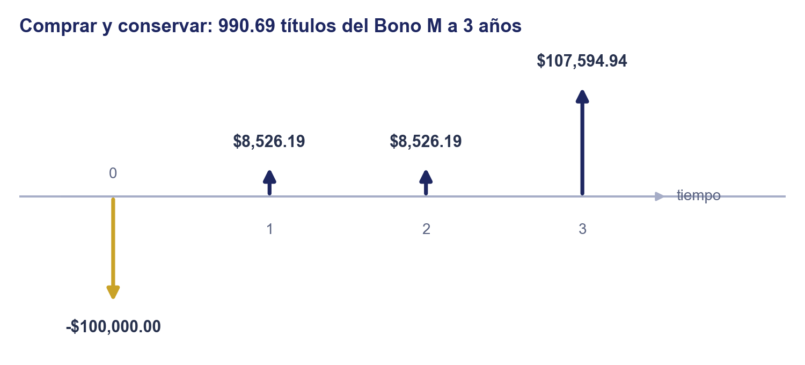

**Escalera** (*ladder*). Se reparte el dinero en montos iguales que vencen a plazos sucesivos, del más corto al más largo. Cada vez que vence un tramo se reinvierte en el plazo más largo, a la tasa de ese momento, así que el riesgo de tasa y el de reinversión se promedian: ningún escenario arruina el portafolio completo.

> **Ejemplo resuelto.** Una persona tiene \$100,000 en cetesdirecto, sin opinión sobre las tasas, y quiere disponer de una parte cada pocos meses, así que pone \$25,000 en cada plazo de CETES (28, 91, 182 y 364 días).
>
> | Plazo    | Tasa  | Precio por título | Títulos  | Recibe al vencer |
> | -------- | ----- | ----------------- | -------- | ---------------- |
> | 28 días  | 6.25% | \$9.9516          | 2,512.15 | \$25,121.53      |
> | 91 días  | 6.66% | \$9.8344          | 2,542.09 | \$25,420.88      |
> | 182 días | 6.90% | \$9.6629          | 2,587.21 | \$25,872.08      |
> | 364 días | 7.24% | \$9.3179          | 2,683.01 | \$26,830.11      |
>
> La tasa promedio de la escalera es 6.76%, **48 pb** menos que el 7.24% de poner todo a 364 días (las dos son tasas simples), y esa diferencia es el costo de tener dinero disponible pronto.

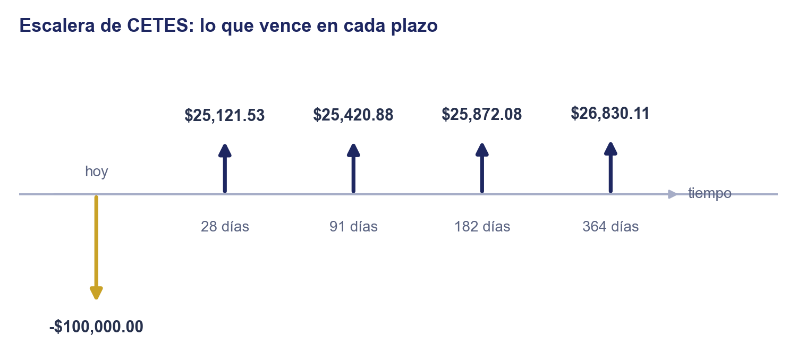

**Indexación** (*indexing*). Se compra un portafolio que replica un índice de bonos para obtener su rendimiento, sin intentar ganarle.

- **El índice** es un portafolio hipotético que calcula y publica un proveedor (como S&P/BMV o VALMER), cuyo valor diario, como si se tuvieran sus bonos y se reinvirtieran sus cupones, sirve de referencia para medir el rendimiento de un mercado.
- **Sus reglas** dicen qué bonos entran, con qué peso y cada cuándo se rebalancea (un índice de CETES, por ejemplo, incluye los CETES en circulación ponderados por su valor de mercado, y cada mes saca los que vencen y agrega los nuevos).
- **La réplica completa** compra todos los bonos del índice en sus mismos pesos, y es viable cuando son pocos, como los CETES.
- **El muestreo estratificado** compra una muestra que iguala las características principales del índice (plazo, sector, calificación, cupón), cuando el índice tiene cientos de bonos.
- **El vehículo** casi siempre es un fondo de inversión de deuda o un fondo cotizado en bolsa (*exchange-traded fund*, ETF; en México, TRAC), como los de la tabla (los TRAC de iShares sobre CETES y Bonos M, como el CETETRAC, se amortizaron en 2024).
- **El error de seguimiento** (*tracking error*) es la desviación estándar de la diferencia entre el rendimiento del fondo y el del índice, y la comisión, los costos de compraventa y el efectivo sin invertir dejan al fondo un poco por debajo.

| ETF (clave)                                         | Índice que replica                      | Qué bonos contiene                                                              |
| --------------------------------------------------- | --------------------------------------- | ------------------------------------------------------------------------------- |
| iShares Core U.S. Aggregate Bond (AGG)              | Bloomberg U.S. Aggregate                | Bonos de EE.UU. con grado de inversión (del Tesoro, hipotecarios, corporativos) |
| Vanguard Total Bond Market (BND)                    | Bloomberg U.S. Aggregate Float Adjusted | Los mismos, sin contar los que tiene la Reserva Federal                         |
| iShares 20+ Year Treasury Bond (TLT)                | ICE U.S. Treasury 20+ Year              | Bonos del Tesoro de EE.UU. a más de 20 años                                     |
| iShares J.P. Morgan USD Emerging Markets Bond (EMB) | J.P. Morgan EMBI Global Core            | Bonos soberanos de países emergentes en dólares, entre ellos los UMS de México  |

**Comprar directo o a través de un fondo.** Una persona puede comprar CETES, Bonos M, UDIBONOS y Bondes en cetesdirecto desde \$100, sin comisión, y conservarlos al vencimiento; a cambio, ella misma lleva las fechas y reinvierte. Un fondo da liquidez diaria y diversificación sin trámites, pero cobra comisión y no tiene fecha de vencimiento: el precio de un fondo de bonos de mediano o largo plazo sube y baja con las tasas todo el tiempo (el de uno de CETES casi no se mueve), así que **no sirve para asegurar un pago con fecha**. Para eso está la siguiente familia.

> **Ejemplo resuelto (ilustrativo).** Una persona invierte \$100,000. Directo, en un CETE a 364 días, gana 7.32% en el año. Un fondo que replica un índice de CETES le entrega lo que rinda el índice menos su comisión; si el índice rinde lo mismo que el CETE y cada año se reinvierte a esa misma tasa:
>
> | Cómo invierte         | Rendimiento anual | Al cabo de 1 año | Al cabo de 10 años |
> | --------------------- | ----------------- | ---------------- | ------------------ |
> | Directo, sin comisión | 7.32%             | \$107,320.44     | \$202,686.41       |
> | Fondo, comisión 0.5%  | 6.82%             | \$106,820.44     | \$193,438.90       |
> | Fondo, comisión 1%    | 6.32%             | \$106,320.44     | \$184,572.86       |
>
> En un año la comisión de 0.5% cuesta \$500; en diez cuesta **\$9,247.51**, porque lo que se paga de comisión deja de generar intereses. A cambio, el fondo da liquidez diaria y nadie tiene que renovar cada CETE al vencer. Las comisiones son ilustrativas: cada fondo publica la suya en su prospecto.

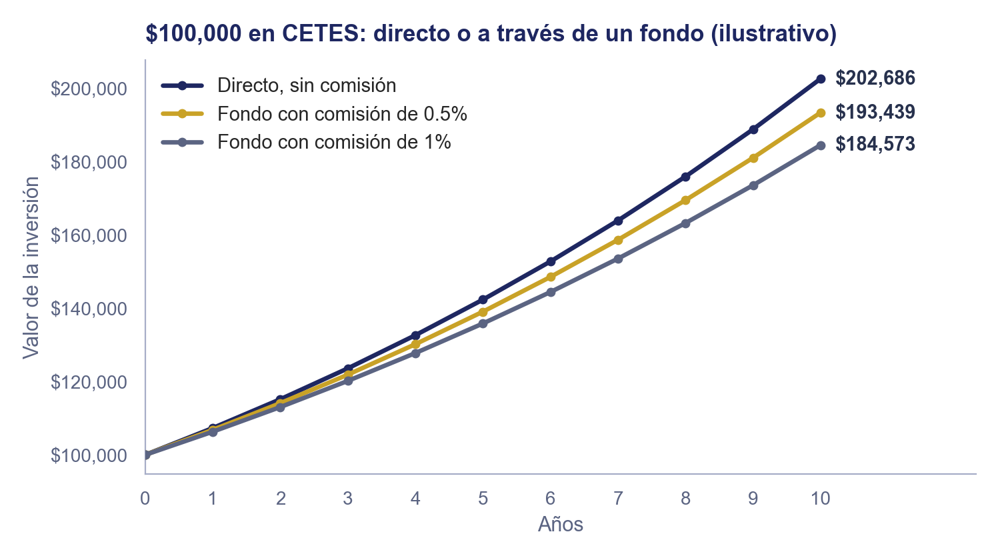

### 3. Estrategias dirigidas por pasivos: calce de flujos

Cuando el objetivo es pagar una obligación, el riesgo que importa no es ganar menos que el mercado, sino no tener el dinero en la fecha del pago. Ese caso es más común de lo que parece: una familia sabe cuándo vence la colegiatura o el enganche de una casa; una empresa, cuándo paga a un proveedor o cuándo vence un crédito que pidió; una aseguradora o un fondo de pensiones, cuánto tendrá que pagar en rentas y siniestros durante años. Fabozzi agrupa las respuestas en las **estrategias dirigidas por pasivos** (*liability-driven*), y esta sección desarrolla la más directa: el calce de flujos.

**Definición:** el **calce de flujos** (*cash flow matching*) consiste en comprar bonos cuyos pagos cubran cada pago de una obligación en su fecha, y conservarlos hasta su vencimiento.

Como no se vende nada antes de tiempo, el precio de mercado de los bonos deja de importar después de comprarlos: no hay riesgo de tasa de interés. Como cada flujo se usa el mismo día que llega, tampoco hay que reinvertirlo: no hay riesgo de reinversión, salvo por lo que sobre.

El portafolio se arma **hacia atrás**, empezando por el último pago. Si la obligación paga $o_t$ en el periodo $t$, se cubre $o_N$ con un bono que vence en $N$; los cupones de ese bono llegan también en las fechas anteriores y reducen lo que falta ahí; se repite con el siguiente pago hacia atrás.

¿De dónde sale la fórmula? En el periodo $N$, cada título de un bono con cupón $c$ y valor nominal $v_N$ paga su último flujo, $c+v_N$ (el vector de [`1_valuacion_instrumentos_deuda.md`](1_valuacion_instrumentos_deuda.md#1-los-flujos-de-un-bono-y-las-incógnitas-que-se-despejan)). Para que $q_N$ títulos paguen exactamente $o_N$ hace falta $q_N(c+v_N)=o_N$, y en cada fecha anterior esos mismos títulos ya cubren $q_Nc$:

$$q_N = \dfrac{o_N}{c+v_N} \qquad\text{y}\qquad \text{falta en } t<N:\ o_t - q_Nc \qquad (c+v_N>0)$$

- **$o_t$**: pago de la obligación en el periodo $t$ (\$100,000 en los años 1 y 3 del ejemplo).
- **$N$**: último periodo con pago, el plazo del primer bono que se compra.
- **$q_N$**: número de títulos del bono que vence en $N$.
- **$c$**: cupón por periodo de cada título de ese bono.
- **$v_N$**: valor nominal de cada título (\$100 en un Bono M).

> **Ejemplo resuelto.** Un fondo de becas tiene que pagar \$100,000 dentro de un año y otros \$100,000 dentro de tres, y arma el calce hacia atrás con los precios de cetesdirecto.
>
> 1. **Año 3.** Compra $q_3 = 100{,}000/108.61 \approx 920.76$ títulos del Bono M a 3 años (precio \$100.94, cupón anual \$8.61), que cuestan \$92,941.17.
> 2. **Año 1.** Esos títulos pagan \$7,924.34 de cupón en el año 1, así que faltan \$92,075.66, que cubre con CETES a 364 días al 7.24% por \$85,795.08.
> 3. **Año 2.** No hay pago, y el cupón de \$7,924.34 del Bono M queda como **sobrante**.
>
> | Año | Obligación | Flujo del portafolio | Sobrante   |
> | --- | ---------- | -------------------- | ---------- |
> | 1   | \$100,000  | \$100,000.00         | \$0.00     |
> | 2   | \$0        | \$7,924.34           | \$7,924.34 |
> | 3   | \$100,000  | \$100,000.00         | \$0.00     |
>
> El portafolio cuesta **\$178,736.26** hoy y paga exactamente lo que se debe, pase lo que pase con las tasas.

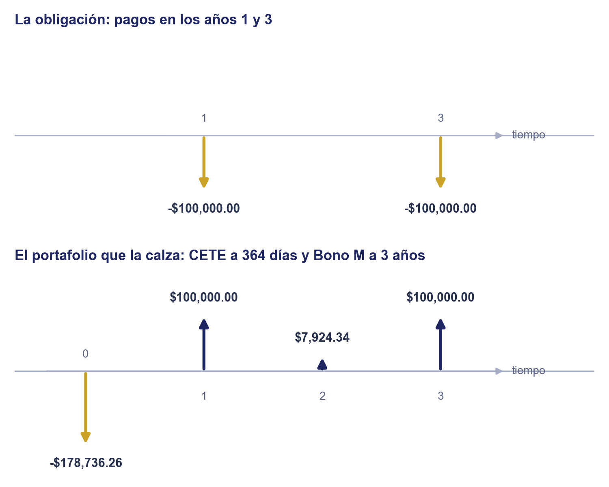

El calce tiene tres límites. No siempre existe un bono que venza en la fecha exacta del pago: el ejemplo funcionó porque había un Bono M a 3 años y un CETE a un año. Los sobrantes sí se reinvierten, y ahí reaparece un poco de riesgo de reinversión. Y pide más efectivo hoy que el valor de la obligación: descontada con las tasas del mismo día (7.32% a un año y 8.24% a tres), la obligación vale \$172,035.24, y el calce cuesta \$6,701.02 más. Ese dinero no se pierde: compra el cupón sobrante del año 2, que hoy vale \$6,826.67 con el 7.74% de la curva a 2 años. Las dos cifras no cuadran al centavo (\$125.65 de diferencia) porque el Bono M se valúa con su propio YTM, 8.24%, y la curva descuenta cada fecha con su propia tasa. El costo real es inmovilizar ese dinero en un flujo que el fondo no necesita, y reinvertirlo cuando llegue.

### 4. Estrategias activas

Quien no tiene una obligación que pagar y sí tiene una opinión puede intentar ganarle al mercado. Fabozzi clasifica las estrategias activas según el tipo de opinión: sobre el **nivel** de las tasas, sobre la **forma de la curva**, sobre los **diferenciales** entre sectores y emisores, y sobre bonos individuales que parezcan baratos. A esas se suman dos opiniones que en México pesan mucho: la inflación (bono nominal o real) y el tipo de cambio.

<!-- diapositivas: conservar -->
Todas se comparan con la misma herramienta, el **rendimiento a horizonte** (o rendimiento total, *total return*): lo que se gana en un año al comprar un bono hoy en $a$, cobrar su cupón $c$ y venderlo al cierre del año en $v_1$, el precio que tenga entonces.

¿De dónde sale la fórmula? Es la TIR de [`4_ciencia_inversion.md`](../unidad1/4_ciencia_inversion.md#8-tasa-interna-de-retorno-tir) para un vector de un solo periodo, $(-a,\ c+v_1)$: la tasa $r_h$ que resuelve $-a + (c+v_1)(1+r_h)^{-1}=0$. El precio de venta $v_1$ es el de un bono al que le quedan $N-1$ periodos, con la fórmula de precio de la nota de valuación y el YTM $r_1$ que tenga el mercado al cierre del año:

$$r_h = \dfrac{c+v_1-a}{a} \qquad\text{con}\qquad v_1 = c\dfrac{1-(1+r_1)^{-(N-1)}}{r_1} + v_N(1+r_1)^{-(N-1)} \qquad (a>0,\ r_1\neq 0)$$

El numerador separa las dos fuentes de retorno que importan en un año: el cupón $c$ y la ganancia o pérdida de precio $v_1-a$. Con esa herramienta, cada estrategia activa se decide con el mismo método:

1. **Escenarios.** Se calcula $r_h$ de la estrategia y de su alternativa segura en varios escenarios para el cierre del año.
2. **Punto de equilibrio.** Se busca el escenario en el que las dos empatan, que no es una opinión del inversionista sino lo que el mercado ya trae en los precios.
3. **Decisión.** Se elige según de qué lado de ese punto está la opinión, porque la estrategia solo gana si lo que pasa se aparta de él en la dirección esperada.

La tabla resume las cinco opiniones de esta sección, cada una con su estrategia, la alternativa contra la que se compara y el punto de equilibrio de su ejemplo:

| Opinión                                         | Estrategia                                | Se compara contra                   | Punto de equilibrio en el ejemplo                  |
| ----------------------------------------------- | ----------------------------------------- | ----------------------------------- | -------------------------------------------------- |
| Las tasas largas bajan, o no suben tanto        | Alargar el plazo (Bono M a 10 años)       | CETE a 364 días                     | Que el YTM a 10 años suba menos de 31 pb           |
| Las tasas cortas suben más de lo esperado       | Cupón variable (Bonde F)                  | CETE a 364 días                     | Una TIIE de Fondeo promedio arriba de 6.99%        |
| La curva no cambia                              | Recorrer la curva                         | Conservar el bono y ganar su YTM    | Gana de 19 a 89 pb más que el YTM si nada cambia   |
| La curva se aplana                              | Barra (CETES y Bono M a 20 años)          | Bala (Bono M a 10 años)             | Que el tramo largo baje más de 17 pb               |
| La inflación supera la implícita                | UDIBONO                                   | Bono M                              | Una inflación promedio arriba de 4.21%             |
| La sobretasa de un emisor no se abre            | Bono corporativo                          | Bono M del mismo plazo              | Que la sobretasa se abra menos de 13 pb            |
| El peso no se deprecia más que el diferencial   | Acarreo (CETES en vez de Treasuries)      | Bono del Tesoro de EE.UU. a un año  | Una depreciación del peso menor a 2.75%            |

#### 4.1 Opinión sobre el nivel de las tasas

**La pregunta.** Un inversionista tiene \$1,000,000 por un año y la opción segura es el CETE a 364 días, que gana 7.32% pase lo que pase, así que su opinión sobre las tasas decide si se aparta de él y hacia dónde.

| Si cree que las tasas...        | Compra, en vez del CETE | Por qué                                        | Le gana al CETE si                               |
| ------------------------------- | ----------------------- | ---------------------------------------------- | ------------------------------------------------ |
| Largas bajan, o suben poco      | Bono M a 10 años        | Su precio sube cuando su tasa baja             | El YTM a 10 años sube menos de 31 pb en el año   |
| Cortas suben más de lo esperado | Bonde F                 | Su cupón sigue a la TIIE de Fondeo día con día | La TIIE de Fondeo promedio queda arriba de 6.99% |
| No se mueven más de lo esperado | Se queda en el CETE     | Fija hoy 7.32% por un año                      | (es la referencia)                               |

**El umbral lo pone el mercado.** El 7.32% del CETE ya trae la expectativa del mercado sobre las tasas del próximo año, y por eso el Bono M y el Bonde F solo le ganan si las tasas se mueven más de lo que esa expectativa anticipa (los 31 pb y el 6.99% de la tabla, que calculan los dos ejemplos).

**Hacia el plazo largo: el Bono M.** Quien cree que las tasas largas bajarán, o subirán menos de lo esperado, alarga el plazo, porque el precio del bono largo es el que más se mueve con la tasa (de 8% a 9%, el precio cae 2.53% a 3 años y 10.27% a 30 años, y sube al revés si la tasa baja).

> **Ejemplo resuelto.** El inversionista de la pregunta, con \$1,000,000 y un horizonte de un año, duda entre dos opciones:
>
> - **A. CETE a 364 días al 7.24%.** Gana $0.0724 \times 364/360 \approx 7.32\%$ en el año, pase lo que pase.
> - **B. Bono M a 10 años**, comprado en \$96.40 (YTM 9.16%, cupón implícito \$8.5951) y vendido al cierre del año como un bono a 9 años.
>
> | Escenario al cierre del año | $r_1$  | Precio de venta $v_1$ | Rendimiento a horizonte $r_h$ |
> | --------------------------- | ------ | --------------------- | ----------------------------- |
> | El YTM del bono baja 100 pb | 8.16%  | \$102.70              | 15.45%                        |
> | El YTM del bono no cambia   | 9.16%  | \$96.64               | 9.16%                         |
> | La curva no cambia          | 9.13%  | \$96.82               | 9.35%                         |
> | El YTM del bono sube 100 pb | 10.16% | \$91.04               | 3.36%                         |
>
> Si el YTM del bono no se mueve, el Bono M rinde justo su YTM. Si baja, rinde más del doble que el CETE; si sube, rinde menos de la mitad. El punto de equilibrio está en un YTM de 9.47% al cierre del año: si el YTM a 10 años sube **más de 31 pb**, el CETE gana. (La fila "la curva no cambia" es otra estrategia, la de la sección 4.2.)

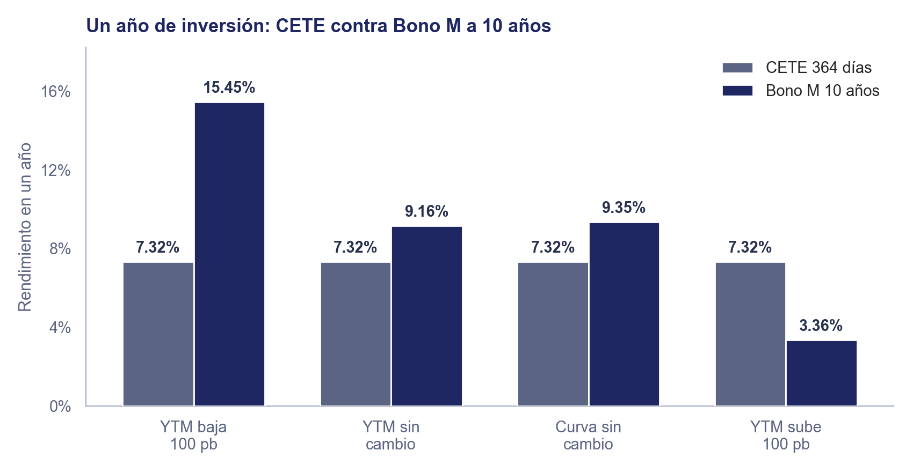

La opinión tiene que ser sobre la tasa a 10 años, no sobre la de Banxico: un recorte de Banxico mueve sobre todo el extremo corto de la curva, y la tasa larga depende más de la inflación esperada a largo plazo y de las tasas de EE.UU. La tasa objetivo de Banxico bajó de 11.25% a 6.50% desde marzo de 2024, 4.75 puntos porcentuales ([`3_riesgos_mercado_deuda.md`](3_riesgos_mercado_deuda.md#2-riesgo-de-tasa-de-interés) mide el mismo ciclo con la tasa interbancaria a 3 meses), y aun así el Bono M a 10 años rendía 9.16%, contra 7.24% del CETE a un año. Los 31 pb son lo que la curva ya trae implícito (la tasa forward del [apéndice de la nota de rendimiento](2_rendimiento_y_curva_de_rendimientos.md#apéndice-de-la-curva-de-ytm-a-la-curva-spot)).

**Hacia el cupón variable: el Bonde F.** Quien cree que Banxico subirá su tasa más de lo esperado compra un Bonde F, porque su cupón sube con la TIIE de Fondeo y su precio casi no se aleja de la par, y así gana el alza en vez de perder con ella.

El **Bonde F** ([`1_valuacion_instrumentos_deuda.md`](1_valuacion_instrumentos_deuda.md#4-valuación-con-cupón-variable)) paga un cupón que se devenga con la TIIE de Fondeo, la tasa a un día que sigue de cerca a la tasa objetivo de Banxico, capitalizada día con día, y se paga cada 28 días. Para la tesorería de una empresa es una alternativa a renovar CETES.

¿De dónde sale la fórmula? Comprado a la par en fecha de cupón, con sobretasa cero y los cupones reinvertidos en el mismo instrumento, el Bonde F crece cada día por el factor $1+r_{fond}/360$, con $r_{fond}$ la TIIE de Fondeo. Es la capitalización de [`4_ciencia_inversion.md`](../unidad1/4_ciencia_inversion.md) con un periodo por día; en 364 días, si la tasa promedio es $r_{fond}$:

$$r_h = \left(1+\dfrac{r_{fond}}{360}\right)^{364} - 1$$

> **Ejemplo resuelto.** El mismo inversionista compara ahora el Bonde F con el CETE a 364 días, con la tasa objetivo de Banxico en 6.50% (la mantuvo el 24 de septiembre):
>
> | TIIE de Fondeo promedio del año | Rendimiento del Bonde F | Rendimiento del CETE a 364 días |
> | ------------------------------- | ----------------------- | ------------------------------- |
> | 6.50% (no cambia)               | 6.79%                   | 7.32%                           |
> | 7.00% (sube 50 pb)              | 7.33%                   | 7.32%                           |
> | 7.50% (sube 100 pb)             | 7.88%                   | 7.32%                           |
>
> El Bonde F empata al CETE con una TIIE de Fondeo promedio de **6.99%**, unos 49 pb arriba de la actual: la curva ya le paga al CETE a un año por un alza de casi medio punto, y el Bonde F solo gana si el alza resulta mayor. Esos 49 pb no son solo el alza que espera el mercado: incluyen una prima por plazo, lo que cobra quien fija su tasa un año en vez de un día.

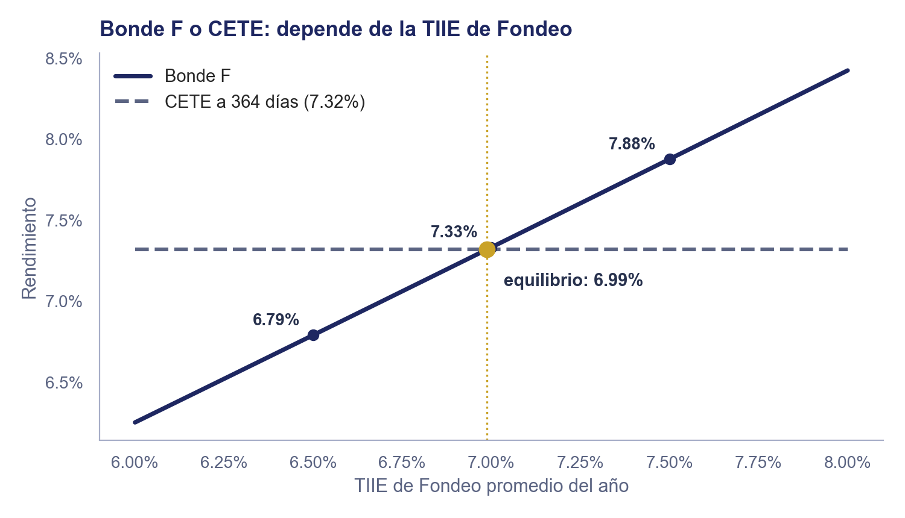

#### 4.2 Opinión sobre la forma de la curva

**La pregunta.** El inversionista de la sección 4.1 ya decidió alargar el plazo, y ahora se pregunta en qué parte de la curva le conviene poner el dinero, según lo que crea que hará su forma.

| Si cree que la curva...         | Compra                                               | Por qué                                                | Gana si                                               |
| ------------------------------- | ---------------------------------------------------- | ------------------------------------------------------ | ----------------------------------------------------- |
| No cambia                       | Un bono que vende un año después (recorrer la curva) | Baja un año de plazo y se vende con un YTM menor       | La curva no cambia: gana de 19 a 89 pb más que su YTM |
| Se aplana                       | Barra: CETES y Bono M a 20 años                      | El extremo largo gana precio cuando su tasa baja       | El tramo largo baja más de 17 pb frente al resto      |
| Se empina, o no se aplana tanto | Bala: Bono M a 10 años                               | Todo queda en el tramo medio, que no depende del largo | El tramo largo no baja más de 17 pb                   |

**El umbral lo pone el mercado.** La forma de la curva de hoy ya trae lo que el mercado espera de cada plazo, así que recorrerla solo gana si la curva se queda como está, y la barra solo le gana a la bala si el tramo largo baja más de los 17 pb que calcula el ejemplo.

Una opinión sobre el **nivel** de las tasas decide si alargar o acortar. Una opinión sobre la **forma** de la curva (los movimientos de pendiente y curvatura de la [sección 4 de la nota de rendimiento](2_rendimiento_y_curva_de_rendimientos.md#4-la-curva-de-rendimientos-ubicar-un-bono)) decide en qué plazos poner el dinero.

**Si la curva no cambia: recorrerla** (*riding the yield curve*). Un bono que se conserva un año baja un año de plazo y, si la curva sube con el plazo y sigue igual, se vende con un YTM menor, así que su precio sube y rinde más que su propio YTM.

Con CETES funciona igual, siempre que se venda antes del vencimiento. Comprar a 364 días y conservarlo no es recorrer la curva: es alargar el plazo.

> **Ejemplo resuelto.** Con la curva del 21 de septiembre de 2026, si no cambia (los plazos sin cotización se interpolan en línea recta; el 9.13% a 9 años, por ejemplo, entre el 9.00% a 5 años y el 9.16% a 10):
>
> | Compra                    | Se vende como                   | YTM de venta | Rendimiento | Sin recorrer la curva     |
> | ------------------------- | ------------------------------- | ------------ | ----------- | ------------------------- |
> | Bono M a 10 años al 9.16% | Bono M a 9 años, en un año      | 9.13%        | 9.35%       | 9.16%, su YTM             |
> | Bono M a 3 años al 8.24%  | Bono M a 2 años, en un año      | 7.74%        | 9.13%       | 8.24%, su YTM             |
> | CETE a 364 días al 7.24%  | CETE a 182 días, a los 182 días | 6.90%        | 7.32% anual | 6.90%, el CETE a 182 días |
>
> El efecto es chico a 10 años, 19 pb, porque la curva casi no sube entre 5 y 10 años, y grande en el tramo corto, donde sube 50 pb por año: el Bono M a 3 años gana **89 pb** sobre su YTM. El CETE le sirve a quien necesita el dinero en 182 días: gana 42 pb más que si hubiera comprado el CETE a 182. En los tres casos, si las tasas suben, puede ganar menos.

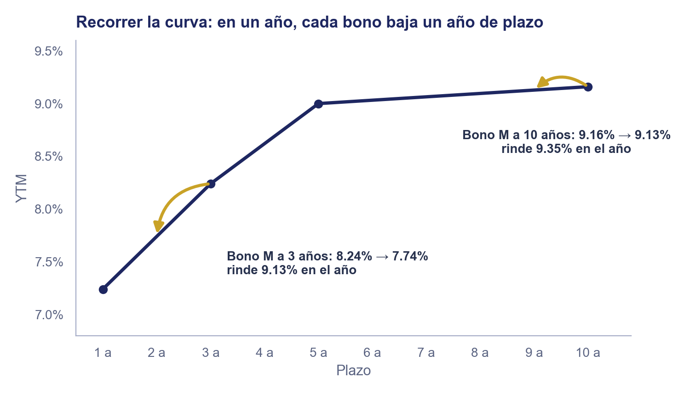

**Si la curva cambia de pendiente: bala o barra.** Con el mismo plazo promedio, la bala (*bullet*) pone todo cerca de un solo plazo y la barra (*barbell*) lo reparte entre los extremos, CETES y Bonos M a 20 o 30 años sin nada en medio, y cada una gana con un cambio distinto de la pendiente.

La comparación solo es justa si las dos tienen un **plazo promedio parecido**; si no, una de las dos simplemente apuesta más al nivel de las tasas. Aun con el mismo plazo promedio la igualdad es aproximada: si toda la curva sube o baja lo mismo, la bala y la barra tampoco ganan ni pierden igual.

> **Ejemplo resuelto.** El mismo inversionista, con \$1,000,000 y un horizonte de un año, compara dos formas de tener un plazo promedio de 10 años:
>
> - **Bala:** todo en el Bono M a 10 años de la sección 4.1.
> - **Barra:** CETES a 364 días y el Bono M a 20 años (precio \$86.34, YTM 9.64%, cupón implícito anual \$8.07). Para que el plazo promedio, ponderado por el dinero, sea de 10 años como el de la bala, la fracción $w$ en el Bono M a 20 años sale de $(1-w)(1) + w(20) = 10$: $w = 9/19$, es decir \$473,684.21 en el Bono M a 20 años y \$526,315.79 en CETES.
>
> Con el tramo medio de la curva sin cambio, la bala rinde siempre 9.35%, lo de recorrer la curva. La barra depende de lo que haga el tramo largo:
>
> | Escenario al cierre del año                   | YTM del Bono M a 19 años | Bala  | Barra  |
> | --------------------------------------------- | ------------------------ | ----- | ------ |
> | La curva se aplana: el tramo largo baja 50 pb | 9.09%                    | 9.35% | 10.81% |
> | La curva no cambia                            | 9.59%                    | 9.35% | 8.62%  |
> | La curva se empina: el tramo largo sube 50 pb | 10.09%                   | 9.35% | 6.58%  |
>
> Si la curva no cambia, la barra rinde menos: más de la mitad está en CETES al 7.32%, y con una curva que sube con el plazo ese es su costo. La barra solo gana si la curva se aplana lo suficiente, si el YTM del Bono M a 19 años queda más de **17 pb** abajo del de la curva de hoy (9.42% o menos).

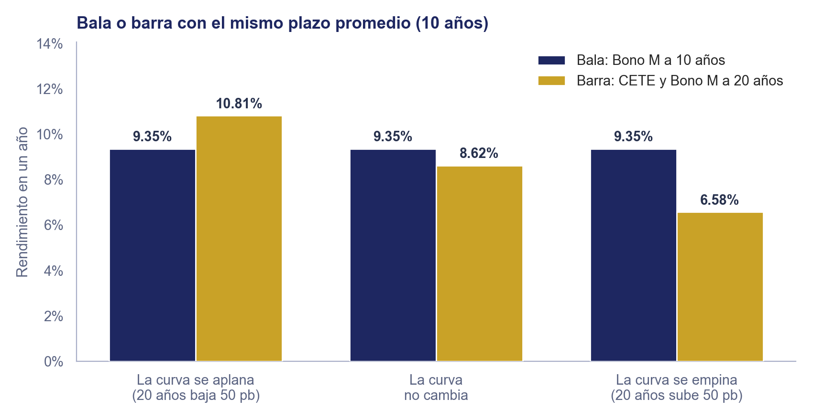

La **mariposa** (*butterfly*) lleva la idea un paso más allá: apuesta a la curvatura, comprando el tramo medio y vendiendo los extremos, o al revés.

#### 4.3 Opinión sobre la inflación

**La pregunta.** El mismo inversionista ya eligió un bono a 10 años que va a conservar al vencimiento, y ahora se pregunta si le conviene en pesos nominales (Bono M) o en UDIs (UDIBONO), según lo que crea que hará la inflación.

| Si cree que la inflación promedio de los 10 años... | Compra            | Por qué                                                     | Gana si                                     |
| --------------------------------------------------- | ----------------- | ----------------------------------------------------------- | ------------------------------------------- |
| Queda abajo de la implícita                         | Bono M a 10 años  | Su tasa nominal es fija, y menos inflación deja más real    | La inflación promedio queda abajo de 4.21%  |
| Queda arriba de la implícita                        | UDIBONO a 10 años | Paga una tasa real sobre un valor que sube con la inflación | La inflación promedio queda arriba de 4.21% |
| Es incierta y no quiere correr ese riesgo           | UDIBONO a 10 años | Asegura 4.75% real pase lo que pase                         | (es una cobertura, no una apuesta)          |

**El umbral lo pone el mercado.** La diferencia entre el YTM del Bono M y el del UDIBONO es la inflación implícita, lo que el mercado ya trae en los precios, así que el UDIBONO solo le gana al Bono M si la inflación promedio de los diez años queda arriba de ella (el 4.21% que calcula el ejemplo).

El Bono M paga una tasa nominal fija; el UDIBONO, una tasa real sobre un valor nominal en UDIs, que se ajusta con la inflación observada ([`3_riesgos_mercado_deuda.md`](3_riesgos_mercado_deuda.md#4-riesgo-de-inflación)). Si los dos se conservan al vencimiento, la comparación depende de una sola cifra: la inflación promedio del plazo.

¿De dónde sale la fórmula? Es la ecuación de Fisher de [`4_ciencia_inversion.md`](../unidad1/4_ciencia_inversion.md): con un YTM nominal $r_{nom}$ y una inflación promedio $r_{inf}$, el Bono M gana en términos reales

$$r_{real} = \dfrac{1+r_{nom}}{1+r_{inf}} - 1 \qquad (r_{inf}>-1)$$

y el UDIBONO gana su tasa real pactada. Igualar las dos da la **inflación implícita** (*breakeven inflation*) del apéndice de la nota de rendimiento, que allá se aproxima con la resta $r_{nom}-r_{real}$.

> **Ejemplo resuelto.** El mismo inversionista compara, a 10 años, el Bono M al 9.16% con el UDIBONO al 4.75% real.
>
> La resta da una inflación implícita de 4.41%, y la cuenta exacta, $1.0916/1.0475-1$, da **4.21%**.
>
> | Inflación promedio de los 10 años | Rendimiento real del Bono M | Rendimiento real del UDIBONO |
> | --------------------------------- | --------------------------- | ---------------------------- |
> | 3% (la meta de Banxico)           | 5.98%                       | 4.75%                        |
> | 4.21% (la implícita)              | 4.75%                       | 4.75%                        |
> | 6%                                | 2.98%                       | 4.75%                        |
>
> La inflación de la primera quincena de septiembre de 2026 fue 3.42%, y Banxico espera llegar a la meta de 3% hacia finales de 2027. El 4.21% no es solo la inflación que espera el mercado: incluye una prima que cobra quien acepta el riesgo de inflación con el Bono M, y otra porque el UDIBONO es menos líquido, así que la inflación esperada suele ser algo menor.

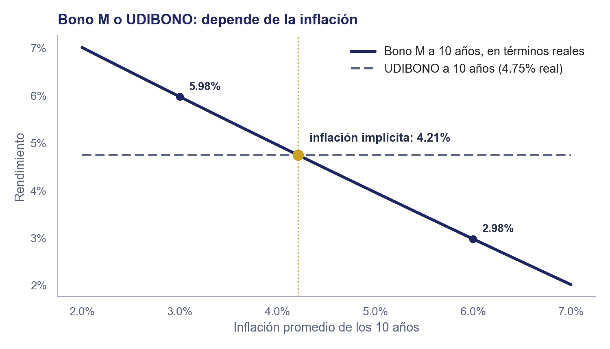

#### 4.4 Opinión sobre el crédito

**La apuesta.** Que la sobretasa de un emisor no se abra más de lo que su cupón extra aguanta.

**Cómo se arma.** Se compra el bono corporativo o bancario en vez del Bono M del mismo plazo, para ganar su sobretasa.

**Cuándo conviene.** El corporativo conviene si se cree que su sobretasa se abrirá menos de 13 pb en el año (el punto de equilibrio del ejemplo) y que el emisor no incumplirá, y el Bono M si no.

La [sección 4 de la nota de rendimiento](2_rendimiento_y_curva_de_rendimientos.md#4-la-curva-de-rendimientos-ubicar-un-bono) ubicó un bono corporativo a 10 años 0.79 pp por encima de la curva: esa es su **sobretasa**, y paga dos cosas, el riesgo de crédito del emisor y su menor liquidez ([`3_riesgos_mercado_deuda.md`](3_riesgos_mercado_deuda.md#3-riesgo-de-crédito-y-calificaciones)). Es una de las decisiones más frecuentes de quien administra deuda: ganar más cupón a cambio de ese riesgo. Se compara con el mismo rendimiento a horizonte, con $r_1$ igual al YTM del Bono M a 9 años más la sobretasa que tenga el corporativo al cierre del año.

> **Ejemplo resuelto (ilustrativo).** El bono corporativo de la nota de rendimiento (cupón de \$8, precio de \$88, YTM de 9.95%) contra el Bono M a 10 años, si el YTM del Bono M no cambia (9.16% en el año):
>
> | Sobretasa al cierre del año | $r_1$  | Rendimiento a horizonte del corporativo | Rendimiento del Bono M |
> | --------------------------- | ------ | --------------------------------------- | ---------------------- |
> | Se cierra 25 pb (0.54 pp)   | 9.70%  | 11.47%                                  | 9.16%                  |
> | No cambia (0.79 pp)         | 9.95%  | 9.94%                                   | 9.16%                  |
> | Se abre 50 pb (1.29 pp)     | 10.45% | 6.98%                                   | 9.16%                  |
>
> El corporativo gana 78 pb más si nada cambia, pero empata al Bono M si su sobretasa se abre solo **13 pb**, hasta 0.92 pp: cada punto base de sobretasa le pega al precio igual que un punto base de tasa a 9 años. Y si el emisor incumple, la pérdida es de capital, no de unos puntos base.

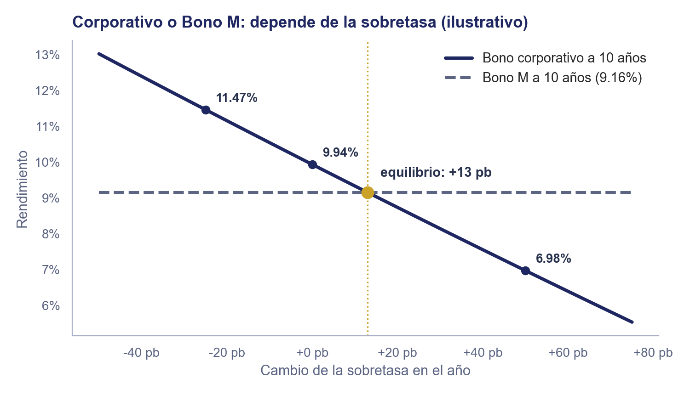

Lo mismo vale entre **sectores**: un bono bancario suele pagar una sobretasa distinta de la de uno corporativo del mismo plazo y calificación, y uno de un estado o municipio otra. Moverse entre gubernamental, bancario y corporativo es una apuesta a que esas sobretasas se cierran o se abren. La **selección de bonos individuales** es la versión más fina: ubicar en la curva un bono cuyo YTM queda por encima de lo que justifican su crédito y su liquidez, y comprarlo esperando que el mercado lo corrija.

#### 4.5 Opinión sobre el tipo de cambio

**La apuesta.** Que el peso no se deprecie más que el diferencial entre las tasas de México y de EE.UU.

**Cómo se arma.** Quien piensa en dólares los cambia a pesos, compra CETES o Bonos M en vez de bonos del Tesoro de Estados Unidos (*Treasuries*) y al vencimiento regresa a dólares, una estrategia llamada **acarreo** (*carry trade*).

**Cuándo conviene.** El acarreo conviene si se cree que el peso se depreciará menos de 2.75% en el año (el punto de equilibrio del ejemplo), y el Treasury si se cree que más o si no se puede correr el riesgo de tipo de cambio.

Para una empresa o un fondo que piensa en dólares, un CETE no rinde 7.32%: rinde lo que quede después de cambiar dólares a pesos hoy y pesos a dólares al vencimiento. El diferencial entre las tasas de México y de EE.UU. paga dos cosas: la depreciación del peso que el mercado espera y una prima por el riesgo de invertir en pesos (el riesgo país de la [sección 1.3 de la nota de rendimiento](2_rendimiento_y_curva_de_rendimientos.md#13-por-qué-importa-el-ytm) es parte de ella). Ese diferencial atrae dinero de fuera, y por eso las tasas de México responden a las de EE.UU.

¿De dónde sale la fórmula? Con $s_0$ y $s_1$ el tipo de cambio en pesos por dólar hoy y al cierre del año, un dólar se convierte en $s_0$ pesos, que crecen a $s_0(1+r_{MXN})$ con la tasa en pesos $r_{MXN}$, y regresan como $s_0(1+r_{MXN})/s_1$ dólares. Restar el dólar invertido da el rendimiento en dólares $r_h$, e igualarlo con la tasa en dólares $r_{USD}$ da la depreciación del peso que los deja en empate:

$$r_h = (1+r_{MXN})\dfrac{s_0}{s_1} - 1 \qquad\text{y}\qquad \dfrac{s_1}{s_0} - 1 = \dfrac{1+r_{MXN}}{1+r_{USD}} - 1 \qquad (s_1>0,\ r_{USD}>-1)$$

> **Ejemplo resuelto.** El tipo de cambio era 17.2252 pesos por dólar y el Treasury a un año rendía 4.45% (FRED). Un inversionista con dólares compara un CETE a 364 días (7.32%) con el Treasury:
>
> | Tipo de cambio al cierre del año | Precio del dólar | Rendimiento en dólares del CETE | Treasury a un año |
> | -------------------------------- | ---------------- | ------------------------------- | ----------------- |
> | 16.71                            | Baja 3%          | 10.64%                          | 4.45%             |
> | 17.23                            | No cambia        | 7.32%                           | 4.45%             |
> | 18.09                            | Sube 5%          | 2.21%                           | 4.45%             |
>
> El punto de equilibrio es una depreciación del peso de **2.75%**, hasta 17.70 pesos por dólar: con menos, gana el acarreo; con más, el Treasury. Ese 2.75% es el que fija hoy el tipo de cambio a plazo (*forward*), no necesariamente la depreciación que de verdad ocurre: con frecuencia el peso se deprecia menos que el diferencial, y por eso el acarreo suele ganar, hasta que un episodio de depreciación fuerte se lleva en semanas lo ganado en meses. Cuatro días después, el 25 de septiembre, el dólar ya estaba en 17.69: casi todo el margen de un año se había ido en cuatro días.

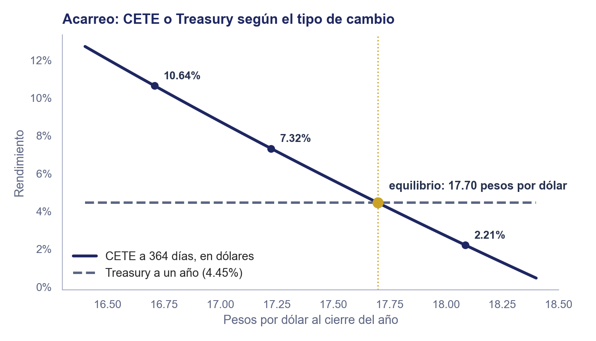

#### 4.6 Lo que tienen en común

**La misma advertencia.** En las cinco opiniones la curva ya trae una expectativa de mercado (de tasas, de inflación, de crédito o de tipo de cambio), y la estrategia solo gana si lo que pasa se aparta de ella en la dirección que el inversionista espera.

**Apalancamiento y derivados.** Los profesionales amplifican estas apuestas con **apalancamiento**, por ejemplo comprando un Bono M con dinero prestado en reporto para ganar la diferencia entre su rendimiento y el costo del reporto (si las tasas suben, la pérdida también se multiplica), o las ajustan sin vender bonos con **derivados**, como los futuros sobre el Bono M y los contratos de intercambio de tasas (*swaps*) de TIIE de MexDer; las dos quedan fuera de esta unidad.

### 5. La estrategia según quién invierte

El proceso de la sección 1 empieza por el objetivo y las restricciones, y la tabla lo aplica a los inversionistas más comunes: primero se elige la familia según la situación, y solo después, si hay opinión, la estrategia activa. Un mismo instrumento cambia de familia según para qué se compre: quien compra UDIBONOS porque apuesta a que la inflación superará la implícita hace una estrategia activa; quien los compra para no correr ese riesgo, sin opinión, se cubre, y eso es una estrategia pasiva (así aparece en la tabla). Lo mismo con los Bondes F: en la sección 4.1 son una apuesta a que la tasa sube; en la tesorería de una empresa, una forma de que su excedente gane lo que paga Banxico sin apostar.

| Quién                            | Situación                                                    | Familia              | Estrategia                                     | Instrumento                                                                  |
| -------------------------------- | ------------------------------------------------------------ | -------------------- | ---------------------------------------------- | ---------------------------------------------------------------------------- |
| Persona                          | Fondo de emergencia                                          | Pasiva               | Liquidez antes que rendimiento                 | CETES a 28 días que se renuevan, o BONDDIA en cetesdirecto (liquidez diaria) |
| Persona                          | Ahorro de largo plazo sin opinión                            | Pasiva               | Escalera o indexación (sección 2)              | CETES y Bonos M a varios plazos, o un fondo de deuda                         |
| Persona                          | Meta con fecha (colegiatura, enganche)                       | Dirigida por pasivos | Calce (sección 3)                              | CETE o Bono M que venza en esa fecha                                         |
| Persona                          | Temor a la inflación                                         | Pasiva               | Cobertura contra la inflación (sección 4.3)    | UDIBONOS                                                                     |
| Empresa                          | Excedente de tesorería por semanas o meses                   | Pasiva               | Liquidez y tasa que siga a Banxico             | CETES cortos, reporto o Bondes F (sin apostar a la tasa, sección 4.1)        |
| Empresa                          | Pago conocido (proveedor, nómina, vencimiento de un crédito) | Dirigida por pasivos | Calce (sección 3)                              | CETES o Bonos M que venzan en esas fechas                                    |
| Empresa o fondo de deuda         | Opinión sobre el crédito de un emisor                        | Activa               | Diferencial (sección 4.4)                      | Certificados bursátiles corporativos o bancarios                             |
| Inversionista extranjero         | Piensa en dólares                                            | Activa               | Acarreo (sección 4.5)                          | CETES o Bonos M, según su opinión del peso                                   |
| Aseguradora o fondo de pensiones | Rentas y siniestros durante muchos años                      | Dirigida por pasivos | Calce (sección 3)                              | Bonos M y UDIBONOS largos                                                    |

La misma persona cambia de fila con el tiempo, y los fondos de pensiones lo hacen por diseño: las SIEFORES generacionales, que administran el ahorro para el retiro según el año de nacimiento del trabajador, acortan los plazos y bajan el riesgo a medida que se acerca la fecha de retiro, como quien pasa de "ahorro de largo plazo" a "meta con fecha".

Todos los rendimientos de esta nota son antes de costos: la retención del ISR sobre los intereses, las comisiones y el diferencial entre el precio de compra y el de venta (mayor en bonos corporativos que en gubernamentales) reducen lo que de verdad se gana, y pueden cambiar una comparación cerrada. Medir el resultado, el quinto paso del proceso, es restar esos costos y comparar contra la referencia elegida.

---

## Fuentes y referencias recomendadas

- Fabozzi, F. J., & Fabozzi, F. A. (2021). *Bond Markets, Analysis, and Strategies* (10ª ed.). MIT Press: el proceso de inversión; el espectro de estrategias pasivas (comprar y conservar, indexación y error de seguimiento), dirigidas por pasivos (calce de flujos) y activas (expectativas de tasas, estrategias de curva, diferenciales de crédito y de sector, selección de bonos individuales); el rendimiento total a un horizonte y el apalancamiento con reporto.
- Fabozzi, F. J. (2009). *Capital Markets, Financial Management, and Investment Management*. Wiley: el proceso de inversión (objetivo, política, estrategia, selección de activos y medición del resultado).
- Luenberger, D. G. (2013). *Investment Science* (2ª ed.). Oxford University Press: calce de flujos (cash matching).
- Cetesdirecto: tablas de CETES, Bonos M y UDIBONOS del 21 de septiembre de 2026 (precio y tasa por plazo), y descripción de BONDDIA, el fondo de liquidez diaria de Nacional Financiera. Los ejemplos de las secciones 2 a 4 (el bono corporativo y las comisiones del fondo son ilustrativos) se reproducen con `codigo/estrategias.py`, y sus números se comprueban en `codigo/test_estrategias.py`.
- Banco de México: comunicados de política monetaria del 6 de agosto y del 24 de septiembre de 2026 (tasa objetivo de 6.50%, inflación de 3.42% en la primera quincena de septiembre y convergencia a la meta de 3% hacia finales de 2027), y descripción técnica de los Bondes F (cupón de TIIE de Fondeo capitalizada cada 28 días).
- Bolsa Mexicana de Valores: avisos de amortización total de los TRAC de iShares CETETRC (mayo de 2024), M5TRAC y M10TRAC (junio de 2024).
- iShares (BlackRock) y Vanguard: fichas de los ETF AGG, TLT, EMB y BND, con el índice que replica cada uno.
- Federal Reserve Bank of St. Louis, FRED: rendimiento del Treasury a un año (DGS1) y tipo de cambio peso-dólar (DEXMXUS) del 21 y el 25 de septiembre de 2026, en `datos/fred_carry_2026-09-21.csv`.

---

## Cierre de la unidad — Lo esencial para recordar

- Una estrategia se elige primero por el **objetivo** (pagar una obligación o ganar rendimiento en un horizonte), después por las **restricciones** (liquidez, riesgo, regulación), y con eso se elige la **familia**, pasiva, dirigida por pasivos o activa.
- Las **pasivas** compran, conservan y reinvierten sin opinión (comprar y conservar, escalera, indexación), y su riesgo de tasa que queda es el de reinversión.
- La **dirigida por pasivos** asegura una obligación con el **calce de flujos**, que cubre cada pago con un bono que vence en esa fecha, se arma hacia atrás y no tiene riesgo de tasa.
- Las **activas** apuestan con el **rendimiento a horizonte** al nivel de las tasas (plazo, Bondes F), a la curva (recorrerla, bala o barra), a la inflación (UDIBONO), al crédito (sobretasa) o al peso (acarreo), y se justifican con un punto de equilibrio que es lo que el mercado ya trae en los precios (sus expectativas más una prima), como los 31 pb, 49 pb, 17 pb, 4.21%, 13 pb o 2.75% de depreciación de esta nota.
- La persona y la empresa eligen primero la familia según su situación (liquidez, fecha de pago, moneda) y solo después, si tienen opinión, una estrategia activa. Un fondo da liquidez, pero no sirve para calzar.

**Próxima sesión:** examen de la Unidad 2. Después, la Unidad 3: el mercado de participación (acciones, FIBRAs, CKD y CERPIs).
